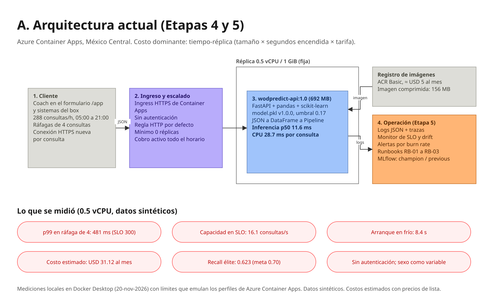
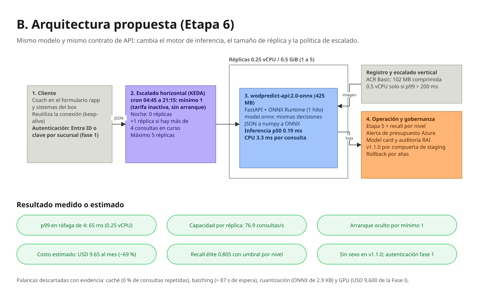
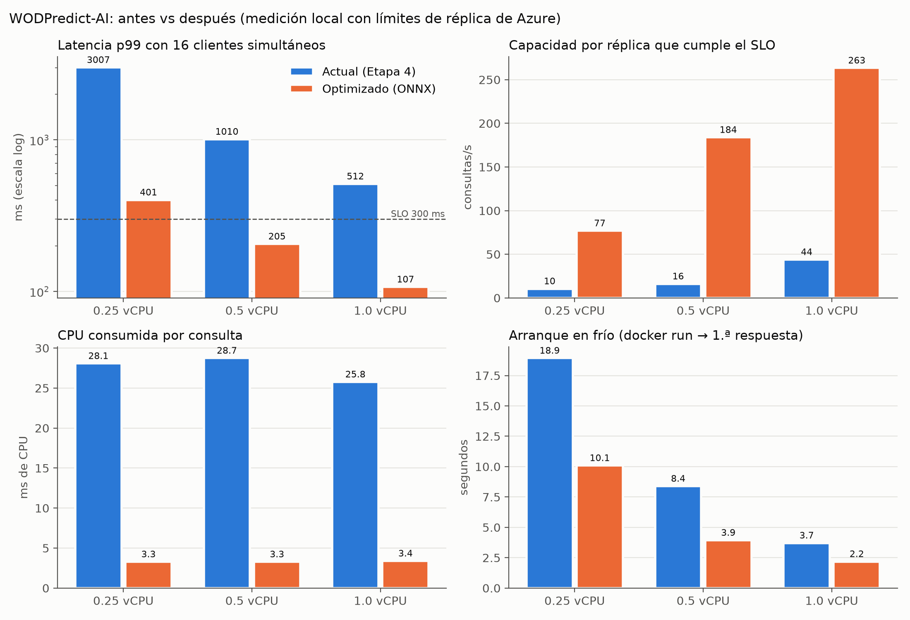
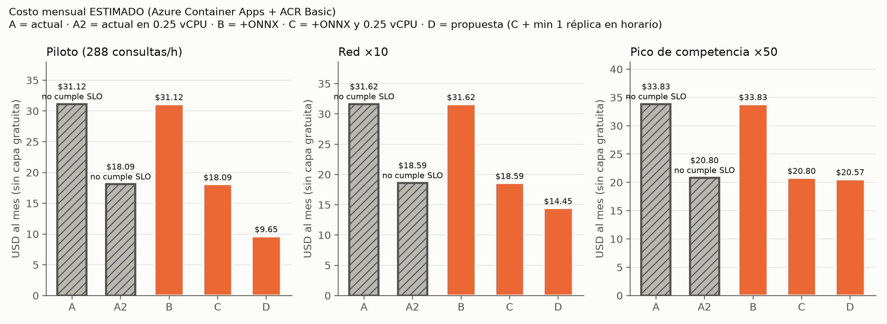
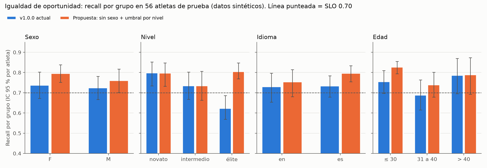

# 🏋️ WODPredict-AI: Escalabilidad, Optimización de Costos y Gobernanza (Etapa 6)

> ## 🧭 Ruta del capstone · WODPredict-AI
>
> Este repositorio es la **etapa 6 de 6** del Master's Capstone WODPredict-AI: el rediseño del despliegue para **escalar con menos costo y con gobernanza responsable** (señal NLP de fatiga → datos y entrenamiento → evaluación y umbral → API y despliegue → monitoreo y gobernanza operativa → escalabilidad, costos y Responsible AI). Consulta [Repositorios relacionados](#-repositorios-relacionados) y [Evolución del proyecto](#-evolución-del-proyecto) más abajo.

## 📌 Resumen
**Nombre del proyecto:** WODPredict-AI (Actividad 9. Escalabilidad, optimización de costos y gobernanza responsable)
Este repositorio toma la API desplegada en la Etapa 4, que aquí es el **sistema actual** y no se modifica, y los SLO de la Etapa 5. Con eso **mide** el sistema actual, aplica tres palancas de optimización (ONNX Runtime, imagen ligera y right-sizing con política de réplicas), **vuelve a medir** con el mismo método, estima el costo en Azure Container Apps bajo principios FinOps y realiza una **auditoría ética, técnica y legal** con evaluación de fairness y un plan de escalamiento responsable por fases.

**Objetivo General:**
Que el servicio que usa el coach para decidir la carga del día pueda crecer de una sucursal a toda la red de **UnderCover Fitness** **manteniendo el SLO** (p99 < 300 ms, también en ráfaga), **al menor costo posible** y con un modelo **justo, trazable y conforme** a los marcos de Responsible AI.

**Contexto Profesional:**
Iniciativa alineada al *Business Case* de UnderCover Fitness para reducir la deserción de atletas en un 25% derivada de lesiones por acumulación de fatiga. La Fase I presupuestó USD 9,600 al año en instancias GPU; con la carga real del proyecto (288 consultas por hora) el costo lo decide el **tiempo-réplica**, no la CPU por consulta, y la propuesta se estima en unos USD 116 al año. El modelo recomienda y el coach decide.

**Qué domina el costo.** El modelo es una regresión logística de 6 KB y una sola réplica basta en todos los escenarios. Por eso la factura es el tamaño de la réplica, por los segundos que está encendida, por la tarifa (activa o inactiva). El registro de imágenes (ACR Basic, ≈ USD 5 al mes) es un costo fijo.

**Palancas elegidas:**

| # | Palanca | Qué cambia | Por qué |
|---|---|---|---|
| 1 | **Inferencia con ONNX Runtime** | El mismo modelo v1.0.0 se ejecuta en ONNX Runtime y ya no pasa por pandas y scikit-learn en cada consulta | La CPU por consulta baja casi 9 veces, lo que da margen para la palanca 3 |
| 2 | **Imagen ligera** | La imagen ya no instala pandas, scipy ni scikit-learn | Arranque en frío entre 41 y 53 % más rápido, la mitad de memoria y una imagen comprimida 35 % menor |
| 3 | **Right-sizing y política de réplicas** | Réplica de 0.25 vCPU / 0.5 GiB con mínimo de 1 réplica solo en horario de los boxes (regla cron) y 0 de noche | Es lo que realmente baja la factura (ver Validación y Resultados) |

**Palancas descartadas, con evidencia:**
*   **Caché:** 0.00 % de consultas repetidas en las 16,498 sesiones de prueba.
*   **Batching:** juntar 8 consultas obligaría a esperar unos 87 s con la carga real.
*   **Cuantización:** el ONNX pesa 2.9 KB y tiene 26 coeficientes, así que no hay nada que ganar y sí riesgo de cambiar decisiones cerca del umbral.
*   **GPU:** la inferencia tarda 0.19 ms en CPU.

## 🧭 Guía rápida
| Pregunta | Respuesta |
|---|---|
| ¿Por dónde empiezo? | `python -m src.ejecutar_todo` ejecuta todo en orden: exportación a ONNX, benchmarks, contenedores antes vs después, costos, fairness y gráficas (≈ 21 min; `--rapido` ≈ 6 min). |
| ¿Dónde están las restricciones? | `config/restricciones.yaml` (calidad, desempeño y costo que ninguna optimización puede romper). |
| ¿Dónde están los supuestos de costo? | `config/precios_azure.yaml` (tarifas de lista y demanda por escenario). |
| ¿Dónde está la política de escalado? | `politicas/autoscaling.yaml` (vertical y horizontal con KEDA; documentada, no desplegada). |
| ¿Dónde está la auditoría? | `gobernanza/auditoria_rai.md` (ética, técnica, legal y plan de escalamiento) y `gobernanza/model_card.md`. |
| ¿Dónde quedan los resultados? | `resultados/`: JSON, CSV y gráficas de la corrida de referencia. Capturas de la ejecución en `evidencias/`. |
| ¿Cómo se ejecutan las pruebas? | `pytest tests/ -v` (7 pruebas del contrato de la API optimizada). |

## 🏗️ Arquitectura

**Actual (Etapas 4 y 5):**



**Propuesta (Etapa 6):**



Diagramas elaborados en Miro (tablero completo en `evidencias/07_Miro_Arquitectura.png`). La API optimizada (`servicio_optimizado/app.py`) conserva **el mismo contrato** de la Etapa 4, así que el formulario y las pruebas siguen funcionando:

| Método | Endpoint | Qué hace |
|---|---|---|
| GET | `/` | Health check, versión del modelo y motor de inferencia (ONNX Runtime) |
| GET | `/modelo` | Ficha del modelo (versión, umbral, métricas) |
| POST | `/predict` | Riesgo de sobrecarga de un atleta (mismo JSON de 23 variables y misma respuesta que la Etapa 4) |
| GET | `/docs`, `/app` | Swagger y formulario web (igual que en la Etapa 4) |

**Política de escalado (`politicas/autoscaling.yaml`, documentada, no desplegada):**
*   **Vertical:** 0.25 vCPU / 0.5 GiB. Se sube de perfil solo si el p99 sostenido supera 200 ms sin otra causa en las trazas.
*   **Horizontal:** regla HTTP de KEDA con `concurrentRequests: 4` (medido: con 16 clientes la réplica de 0.25 vCPU ya no cumple el SLO), `max_replicas: 5` como tope de gasto, regla cron de 1 réplica de 04:45 a 21:15 (America/Mexico_City) y 0 de noche.
*   Para producción con datos reales se proponen 2 réplicas mínimas en zonas distintas.
*   **Cliente con keep-alive:** la prueba L01 de la Etapa 4 abría una conexión HTTPS nueva por consulta. Es la causa probable del ≈ 1.1 s medido en Azure, pero es una **hipótesis**: no se puede medir con el despliegue apagado.

## 🛠️ Tecnologías Utilizadas
*   **Lenguaje:** Python 3.12 (también probado con 3.11)
*   **Entorno:** VS Code y Docker Desktop (los benchmarks de contenedores usan `docker run --cpus/--memory` para imitar los perfiles de réplica de Azure Container Apps)
*   **Modelo:** regresión logística (`C = 0.1`) v1.0.0 de la Etapa 4, umbral **0.17**, exportado a ONNX con `skl2onnx`
*   **Inferencia optimizada:** ONNX Runtime (1 hilo) sobre numpy, sin pandas ni scikit-learn en la imagen
*   **API:** FastAPI + Pydantic + uvicorn (mismo contrato que la Etapa 4)
*   **Nube (objetivo):** Azure Container Apps (plan Consumption, México Central), Azure Container Registry Basic, KEDA (reglas HTTP y cron)
*   **Costos:** modelo propio por segundo de réplica (tarifa activa e inactiva) validado contra Azure Cost Management de la Etapa 4
*   **Fairness:** equal opportunity (recall por grupo) con IC 95 % por bootstrap a nivel atleta
*   **Gobernanza:** NIST AI RMF, ISO/IEC 42001, 23894 y 23053, AI Act (como referencia) y LFPDPPP 2025
*   **Pruebas:** pytest (7 pruebas del contrato de la API optimizada)
*   **Documentación:** IA generativa como apoyo para código y documentación, con revisión del autor
*   **Versiones fijas:** `requirements.txt` (las primeras versiones son las mismas de la Etapa 4 para medir el sistema actual tal como es)

## 📁 Estructura del Proyecto

Reutiliza el modelo de la Etapa 4 y la estructura `src/ tests/ config/ resultados/` de la Etapa 5, y agrega `servicio_optimizado/`, `politicas/`, `gobernanza/` y `evidencias/`.

```
WODPredict-AI_etapa-6_escalabilidad-gobernanza/
├── modelo/                    # model.pkl y metadata.json (copia de la Etapa 4), model.onnx, ORIGEN.md (SHA-256)
├── servicio_optimizado/       # API optimizada: app.py (mismo contrato), Dockerfile, requirements.txt, frontend/
├── src/
│   ├── comun.py               # datos (Etapa 2 v1.0), separación por atleta, utilidades
│   ├── exportar_onnx.py       # palanca 1 + restricción de calidad
│   ├── bench_inferencia.py    # inferencia en proceso, arranque del motor, evidencia de caché y batching
│   ├── bench_http.py          # generador de carga (sin keep-alive, keep-alive, concurrente)
│   ├── bench_contenedores.py  # antes vs después con límites de réplica de Azure
│   ├── costos.py              # estimación de costos A/A2/B/C/D por escenario
│   ├── auditoria_fairness.py  # fairness por grupo, bootstrap por atleta, mitigaciones, coeficientes
│   ├── graficas.py            # PNG para el reporte
│   └── ejecutar_todo.py       # todo en orden
├── config/
│   ├── restricciones.yaml     # calidad, desempeño y costo
│   └── precios_azure.yaml     # supuestos de precio y demanda
├── politicas/
│   └── autoscaling.yaml       # política de escalado vertical y horizontal (no desplegada)
├── gobernanza/
│   ├── auditoria_rai.md       # auditoría ética, técnica y legal y plan de escalamiento responsable
│   └── model_card.md          # ficha del modelo
├── tests/
│   ├── test_servicio_optimizado.py  # 7 pruebas del contrato de la API optimizada
│   └── ejemplos/              # perfiles de atleta en JSON (de la Etapa 4)
├── docs/
│   └── capturas/              # diagramas de arquitectura actual y propuesta
├── evidencias/                # capturas de la ejecución (Docker, VS Code, Azure Cost Management, Miro)
├── resultados/                # JSON, CSV y gráficas de la corrida de referencia
├── requirements.txt           # dependencias con versiones fijas
├── .gitignore                 # lo que se queda solo en local (datos/, externos/)
└── README.md
```

## 🔭 Evidencia de Escalabilidad y Gobernanza

| Evidencia | Dónde verla |
|---|---|
| Equivalencia ONNX contra scikit-learn (calidad) | `resultados/calidad_onnx.json` |
| Inferencia en proceso, caché y batching | `resultados/bench_inferencia.json` |
| Contenedores antes vs después (latencia, throughput, CPU, memoria, imagen, arranque) | `resultados/bench_contenedores.json` y `.csv`, `graficas/antes_despues_contenedores.png` |
| Costos por configuración y escenario | `resultados/costos_escenarios.csv`, `costos_resumen.json`, `graficas/costos_escenarios.png` |
| Costo real de la Etapa 4 en Azure (validación del modelo de costos) | `evidencias/06_cost_management_Azure.png` |
| Fairness por grupo y explicabilidad global | `resultados/fairness_por_grupo.csv`, `fairness_resumen.json`, `coeficientes_modelo.csv`, `graficas/fairness_recall_por_grupo.png` |
| Ejecución en el equipo del autor | `evidencias/01_imagenes.png` a `05_docker_stats.png` |
| Diagrama de arquitectura actual vs propuesta | `docs/capturas/` y `evidencias/07_Miro_Arquitectura.png` |

## 📋 Requisitos

| Requisito | Versión | Para qué |
|---|---|---|
| Python | 3.12 (también 3.11) | Exportación a ONNX, benchmarks, costos, fairness y pruebas |
| Docker Desktop | 4.x (motor 29.x) | Construir y medir las imágenes actual y optimizada con límites de CPU y memoria |
| VS Code | Extensión Python | Ejecutar los scripts |
| Git | 2.x | Clonar el repositorio y la Etapa 4 |
| Internet | Solo la primera vez | Descargar `sesiones_limpias.csv` (≈ 19 MB) del tag `v1.0` de la Etapa 2 y clonar la Etapa 4 |
| Hardware | 8 GB de RAM y 3 GB de disco | Dos imágenes Docker (692 MB y 425 MB) y resultados |

## ⚙️ Instalación, Ejecución y Prueba

> Los comandos son para **PowerShell en Windows** con VS Code. En Linux/WSL o macOS cambia `.\.venv\Scripts\Activate.ps1` por `source .venv/bin/activate` y `py -3.12` por `python3.12`.

### 1. Instalación
```powershell
git clone https://github.com/rick-lastra/WODPredict-AI_etapa-6_escalabilidad-gobernanza.git
cd WODPredict-AI_etapa-6_escalabilidad-gobernanza
code .
```
Se crea el ambiente de Python con las versiones fijas:
```powershell
py -3.12 -m venv .venv
.\.venv\Scripts\Activate.ps1
pip install -r requirements.txt
```

### 2. Ejecución (genera toda la evidencia)
Con Docker Desktop abierto:
```powershell
python -m src.ejecutar_todo --rapido   # ≈ 6 min: solo el perfil de 0.5 vCPU
python -m src.ejecutar_todo            # ≈ 21 min: los 3 perfiles y la auditoría de fairness
python -m src.auditoria_fairness       # solo la auditoría de fairness (≈ 30 s, no necesita Docker)
```
Qué hace `ejecutar_todo`:
*   Descarga los datos de la Etapa 2 la primera vez (`datos/`, ignorado por git).
*   Clona la Etapa 4 en `externos/` y construye su imagen **sin cambios**.
*   Construye la imagen optimizada y deja los resultados en `resultados/`, que sobrescriben la corrida de referencia con la de tu equipo.

### 3. API optimizada en vivo
```powershell
docker run -d --name wodpredict-onnx -p 8001:8000 wodpredict-api:2.0-onnx
```
Abre http://localhost:8001/docs y http://localhost:8001/app. Para ver el consumo de la réplica: `docker stats wodpredict-onnx`.

### 4. Prueba
*   **Pruebas automatizadas** (7 pruebas del contrato): `pytest tests/ -v`

## 🧪 Validación y Resultados

> **Tipo de medición.** Son mediciones **reales** en el equipo del autor: Windows 11, AMD Ryzen de 12 hilos, Docker Desktop 29.9 y Python 3.11, el 20-nov-2026. Se usa `docker run --cpus/--memory` para imitar los perfiles de réplica de Azure Container Apps. **No son mediciones en Azure**: el despliegue de la Etapa 4 está apagado. Los datos del equipo están en el campo `entorno` de cada JSON. Las consultas son sesiones reales del conjunto de prueba. El dataset es **sintético** desde su origen (`wodpredict-synth@v1.0`).

**Restricciones (`config/restricciones.yaml`):**

| Tipo | Restricción | Resultado |
|---|---|---|
| **Calidad** | Mismas decisiones que el modelo v1.0.0 en las 16,498 sesiones de prueba (56 atletas nunca vistos), \|Δp\| ≤ 1e-4 y recall ≥ 0.70 | ✅ 0 decisiones distintas, \|Δp\| máx. = 2.9e-7, recall 0.7324 (igual que la Etapa 4) |
| **Desempeño** | SLO de la Etapa 5: p99 < 300 ms y errores ≤ 0.5 %, también en ráfaga de 4 consultas simultáneas (un coach que revisa a varios atletas antes de la clase) | ✅ Propuesta (0.25 vCPU): p99 96 ms con 1 cliente y 65 ms con 4. ❌ El sistema actual en su perfil de 0.5 vCPU tiene p99 de 481 ms con 4 clientes, y en 0.25 vCPU llega a 546 ms |
| **Costo** | Costo mensual estimado ≤ al actual en el piloto, sin contar la capa gratuita | ✅ USD 9.65 contra USD 31.12 al mes (−69 %) |

**Antes vs después:**



| Métrica (réplica de 0.5 vCPU / 1 GiB, perfil por defecto de la Etapa 4) | Actual (Etapa 4) | Optimizado | Cambio |
|---|---|---|---|
| Inferencia en proceso, p50 (`bench_inferencia.json`) | 11.56 ms | 0.19 ms | −98 % |
| Latencia HTTP p50, conexión nueva por consulta (1 cliente) | 32.2 ms | 10.4 ms | −68 % |
| Latencia p99 con 4 clientes simultáneos (ráfaga) | 481 ms ❌ | 60 ms ✅ | −88 % |
| Latencia p99 con 16 clientes simultáneos | 1,010 ms ❌ | 205 ms ✅ | −80 % |
| Capacidad de una réplica que cumple el SLO | 16.1 consultas/s | 183.9 consultas/s | ×11.4 |
| CPU por consulta (4 clientes) | 28.7 ms | 3.3 ms | −89 % |
| Arranque en frío (`docker run` → primera respuesta) | 8.4 s | 3.9 s | −53 % |
| Memoria en reposo | 111 MiB | 51 MiB | −54 % |
| Imagen (sin comprimir / comprimida con gzip) | 692 / 156 MB | 425 / 102 MB | −39 % / −35 % |

*   **Escalado vertical.** La capacidad de la imagen optimizada que cumple el SLO es de 77, 184 y 263 consultas/s con 0.25, 0.5 y 1 vCPU. La imagen actual llega a 10, 16 y 44. Detalle en [`resultados/bench_contenedores.csv`](resultados/bench_contenedores.csv).
*   **Nota sobre keep-alive en Windows.** Con la conexión reutilizada (`requests.Session`), las dos imágenes muestran un piso de unos 48 ms por consulta, aunque el servidor usa solo 3 a 6 ms de CPU. Lo más probable es que sea un retraso del reenvío de puertos de Docker Desktop en Windows: con 4 clientes el throughput sube casi 4 veces, lo que confirma que el servidor no estaba ocupado. Por eso, para la latencia de 1 cliente, se reporta el modo de conexión nueva por consulta. En una corrida de referencia en Linux, el p50 con keep-alive fue de 12.0 ms en la imagen actual contra 2.4 ms en la optimizada.

**Costos estimados (`resultados/costos_escenarios.csv`):**

> **ESTIMACIÓN, NO FACTURA.** Combina los precios de lista de pago por uso y la demanda supuesta de [`config/precios_azure.yaml`](config/precios_azure.yaml) con la capacidad medida por réplica, y aplica las reglas de cobro de Container Apps: una réplica escalada a 0 no cobra; las réplicas por encima del mínimo cobran tarifa activa; las réplicas del mínimo cobran tarifa inactiva en los segundos sin consultas. Las tarifas por segundo deben verificarse en la calculadora de Azure para México Central antes de citarlas.



| Configuración | Cumple SLO | Piloto USD/mes | Red ×10 | Pico ×50 |
|---|---|---|---|---|
| A. Actual (Etapa 4): 0.5 vCPU, min 0 | ❌ en ráfaga | 31.12 | 31.62 | 33.83 |
| A2. Actual en 0.25 vCPU (control sin ONNX) | ❌ en ráfaga | 18.09 | 18.59 | 20.80 |
| B. + ONNX, mismo perfil | ✅ | 31.12 | 31.62 | 33.83 |
| C. + ONNX y 0.25 vCPU | ✅ | 18.09 | 18.59 | 20.80 |
| **D. Propuesta: C + min 1 réplica en horario (cron), 0 de noche** | ✅ | **9.65** | **14.45** | **20.57** |

*   ONNX por sí solo (B) **no baja la factura**, porque con una réplica el costo es tiempo-réplica y no CPU. Lo que la baja es el tamaño de la réplica (C) y la política de réplicas mínimas (D).
*   ONNX es la condición para cumplir el SLO en ráfaga, tanto en 0.25 como en 0.5 vCPU. El control A2 cuesta lo mismo que C, pero no cumple.
*   Con una consulta cada 12.5 s la app nunca escala a 0 en horario. Con min = 0, toda la réplica se cobra a tarifa activa. Con min = 1, el 92 % de los segundos se cobra a tarifa inactiva, que en vCPU es 8 veces más barata.
*   **Validación con la factura real:** Azure Cost Management registró USD 0.82 por los días que la Etapa 4 estuvo encendida en noviembre de 2026 (USD 0.79 de Container Registry ≈ 0.167 al día × 4.7 días, USD 0.03 de Container Apps), cubiertos por el crédito de Azure for Students. Confirma la tarifa del registro y que, con poca carga, el registro es la línea más grande.
*   **Fase I:** el Excel presupuestó **USD 9,600** de "instancias GPU" para el año 1. La propuesta se estima en **unos USD 116 al año** sin capa gratuita.

**Gobernanza responsable:**



| Hallazgo (datos sintéticos, 56 atletas de prueba) | Resultado |
|---|---|
| **Nivel** | ❌ Recall del nivel élite 0.623 (IC 95 % de 0.569 a 0.686), por debajo del SLO de 0.70, contra 0.799 en novatos |
| **Sexo e idioma** | ✅ Sin brecha (0.013 y 0.003) |
| **Edad** | No concluyente por tamaño de muestra |
| **Mitigación 1: quitar `sex`** | No cambia la calidad (recall 0.731 contra 0.732) y mejora el cumplimiento |
| **Mitigación 2: umbral por nivel** (élite 0.10, calibrado solo con entrenamiento) | Recall élite 0.805 y brecha de 0.070, a cambio de más alertas (de 24 % a 30 %) |

*   **Decisión del responsable del modelo (20-nov-2026):** se aprueban las dos mitigaciones. Se aplicarán como modelo v1.1.0 en la fase de preparación del piloto.
*   La autenticación de la API y el consentimiento de los atletas quedan en esa misma fase de preparación: después de aprobar el proyecto y antes de la prueba real de 6 meses en una sucursal de UnderCover Fitness. Hasta entonces el sistema solo usa datos sintéticos.
*   Plan de escalamiento responsable por fases (0 Hoy, 1 Preparación, 2 Piloto, 3 Red completa, 4 ×10) con criterios para pasar de fase: `gobernanza/auditoria_rai.md`, secciones 7 y 8.

| Entregable | Archivos de este repositorio |
|---|---|
| 1. Reporte técnico (arquitectura actual, rediseño, métricas de desempeño y costo, auditoría, plan de escalamiento) | `resultados/*.json`, `resultados/graficas/*.png`, `politicas/autoscaling.yaml`, `gobernanza/auditoria_rai.md` |
| 2. Anexo técnico (tablas de costos, desempeño y fairness) | `resultados/costos_escenarios.csv`, `bench_contenedores.csv`, `fairness_por_grupo.csv`, `config/precios_azure.yaml` |
| 3. Diagrama de arquitectura (actual y propuesto) | `docs/capturas/arquitectura_actual.png`, `arquitectura_propuesta.png`, `evidencias/07_Miro_Arquitectura.png` |
| 4. Código y configuración | `src/`, `servicio_optimizado/`, `config/`, `politicas/` |

## ✅ Criterios

| Criterio  | Evidencia en este repositorio |
| --- | --- |
| 1. Análisis y rediseño de escalabilidad | `src/bench_contenedores.py` (perfiles de 0.25, 0.5 y 1 vCPU: escalado vertical), `politicas/autoscaling.yaml` (KEDA HTTP y cron: escalado horizontal), `servicio_optimizado/`, `bench_contenedores.csv` |
| 2. Optimización de costos y enfoque FinOps | `src/costos.py`, `config/precios_azure.yaml`, `costos_escenarios.csv` (5 configuraciones × 3 escenarios), validación con Azure Cost Management, restricción de SLO en `config/restricciones.yaml` |
| 3. Auditoría de gobernanza, ética y cumplimiento | `src/auditoria_fairness.py`, `fairness_por_grupo.csv`, `gobernanza/auditoria_rai.md` (NIST AI RMF, ISO/IEC 42001 y 23894, AI Act, LFPDPPP 2025), `gobernanza/model_card.md` |
| 4. Plan de escalamiento responsable | `gobernanza/auditoria_rai.md` (fases 0 a 4 con criterios de paso, costos, controles éticos y legales), decisiones del 20-nov-2026 (v1.1.0, autenticación y consentimiento en la fase 1) |

## 📚 Documentación

| Documento | Contenido |
|---|---|
| [`gobernanza/auditoria_rai.md`](gobernanza/auditoria_rai.md) | Auditoría ética, técnica y legal, riesgos, decisiones y plan de escalamiento responsable |
| [`gobernanza/model_card.md`](gobernanza/model_card.md) | Ficha del modelo: uso previsto, datos, métricas por grupo, limitaciones |
| [`politicas/autoscaling.yaml`](politicas/autoscaling.yaml) | Política de escalado vertical y horizontal (documentada, no desplegada) |
| [`config/restricciones.yaml`](config/restricciones.yaml), [`config/precios_azure.yaml`](config/precios_azure.yaml) | Restricciones de calidad, desempeño y costo; supuestos de precio y demanda |
| [`modelo/ORIGEN.md`](modelo/ORIGEN.md) | Procedencia del modelo y huellas SHA-256 |
| `docs/` | Reporte técnico, anexo técnico y diagrama de la Actividad 9, cuando se agreguen |

## ⚠️ Limitaciones
*   Las mediciones son locales con límites de CPU y memoria, y en Windows el modo keep-alive tiene el piso de ≈ 48 ms descrito arriba. Una vCPU de Azure no es idéntica a un núcleo local, y el arranque en frío medido no incluye la descarga de la imagen desde ACR (por eso se reporta también el tamaño comprimido).
*   Los costos son estimaciones con supuestos explícitos (precios de lista, 288 consultas/h, 16 h de operación, 30 días). La factura real de la Etapa 4 valida la tarifa del registro, pero no el cómputo con carga sostenida.
*   La política de escalado está documentada, no desplegada; el despliegue de la Etapa 4 está apagado.
*   La fairness se evaluó con datos sintéticos y 56 atletas de prueba; hay que repetirla con datos reales en el piloto.
*   La API sigue sin autenticación; se implementa en la fase 1 (preparación del piloto), junto con el consentimiento de los atletas.

## 🧩 Repositorios relacionados

Este proyecto se apoya en el trabajo de las etapas previas. Cada repositorio responde una pregunta y explica en su propio README cómo alimenta al siguiente.

| Etapa | Repositorio | Función | Qué reutiliza este repo | Estado |
|---|---|---|---|---|
| 1 | [WODPredict-AI_etapa-1_NLP-fatiga](https://github.com/rick-lastra/WODPredict-AI_etapa-1_NLP-fatiga) | **Comparación de modelos (NLP):** tres modelos preentrenados de Hugging Face evaluados con 84 comentarios etiquetados por el coach | Señal `prob_fatiga` (XLM-R), dos de las 23 variables | `exploratorio`, reemplazado |
| 2 | [WODPredict-AI_etapa-2_preparacion-datos](https://github.com/rick-lastra/WODPredict-AI_etapa-2_preparacion-datos) | **Preparación de datos y entrenamiento:** dataset sintético, limpieza, eliminación de fuga, tres modelos, MLflow | Dataset `v1.0` (consultas de los benchmarks y auditoría de fairness) | `archivado`, reemplazado |
| 3 | [WODPredict-AI_etapa-3_evaluacion-modelo](https://github.com/rick-lastra/WODPredict-AI_etapa-3_evaluacion-modelo) | **Evaluación del modelo:** ajuste del umbral, ROC y validación cruzada, líneas base, prueba A/B simulada | Umbral 0.17 y criterio recall ≥ 0.70 (restricción de calidad y SLI de fairness) | `archivado`, reemplazado |
| 4 | [WODPredict-AI_etapa-4_API-despliegue](https://github.com/rick-lastra/WODPredict-AI_etapa-4_API-despliegue) | **API:** FastAPI, formulario web, Docker, 23 pruebas y despliegue en Azure | Sistema actual que se mide sin cambios, contrato de la API y `model/model.pkl` | `estable`, sistema actual |
| 5 | [WODPredict-AI_etapa-5_monitoreo-observabilidad](https://github.com/rick-lastra/WODPredict-AI_etapa-5_monitoreo-observabilidad) | **Monitoreo y gobernanza operativa:** logs, trazas, SLOs, alertas, drift, runbooks y Model Registry | SLO de latencia (p99 < 300 ms), SLO de calidad y operación de la arquitectura actual | `estable`, base de esta etapa |

El caso de negocio que enmarca todo el proyecto (UnderCover Fitness, Fase I) se entregó como reporte escrito y no es un repositorio; esta etapa actualiza su línea de costos de infraestructura.

## 🔄 Evolución del proyecto

1. **Etapa 1:** se extrae una señal de fatiga de los comentarios de los atletas con un modelo NLP preentrenado.
2. **Etapa 2:** esa señal y las variables de carga de entrenamiento alimentan un clasificador de sobrecarga del día siguiente; se selecciona la regresión logística.
3. **Etapa 3:** el modelo se evalúa con atletas no vistos y el umbral de decisión se fija en 0.17.
4. **Etapa 4:** el modelo se convierte en un artefacto versionado servido por una API FastAPI con formulario web, una imagen Docker y 23 pruebas, desplegada en Azure Container Apps.
5. **Etapa 5:** la API se instrumenta (logs, trazas, métricas), el modelo pasa a un Model Registry con alias, y se agregan SLOs, alertas, detección de drift, runbooks y respuesta automatizada.
6. **Etapa 6 (este repo, Actividad 9):** se mide el sistema actual, se optimiza la inferencia con ONNX Runtime y una imagen ligera, se redimensiona la réplica con una política de escalado por horario, se estima el costo con enfoque FinOps y se audita el modelo (fairness, ética y cumplimiento), con un plan de escalamiento responsable por fases.

Lo que sigue es la fase 1 del plan: modelo v1.1.0 (sin `sex` y con umbral por nivel), autenticación de la API y consentimiento de los atletas, antes de la prueba real de 6 meses con datos reales en una sucursal de UnderCover Fitness.

## 🔗 Enlaces
*   Etapa 5 (monitoreo y observabilidad): https://github.com/rick-lastra/WODPredict-AI_etapa-5_monitoreo-observabilidad
*   Etapa 4 (API): https://github.com/rick-lastra/WODPredict-AI_etapa-4_API-despliegue
*   Etapa 3 (evaluación, validación y umbral): https://github.com/rick-lastra/WODPredict-AI_etapa-3_evaluacion-modelo
*   Etapa 2 (datos y entrenamiento con MLflow): https://github.com/rick-lastra/WODPredict-AI_etapa-2_preparacion-datos
*   Etapa 1 (módulo NLP de fatiga con Hugging Face): https://github.com/rick-lastra/WODPredict-AI_etapa-1_NLP-fatiga
*   Dataset sintético en Hugging Face (versión `v1.0`): https://huggingface.co/datasets/rick-lastra/wodpredict-synth
*   Reglas de cobro de Azure Container Apps: https://learn.microsoft.com/azure/container-apps/billing

## 👥 Contacto y Créditos
*   **Autor:** Ricardo Alejandro Lastra Dueñas
*   **Empresa (Caso de Uso):** UnderCover Fitness
*   **Fecha:** Noviembre 2026
*   **Institución:** Universidad Tecmilenio (Gestión de Proyectos de IA)
